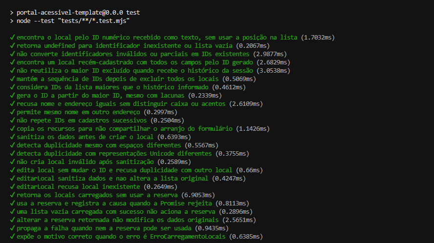
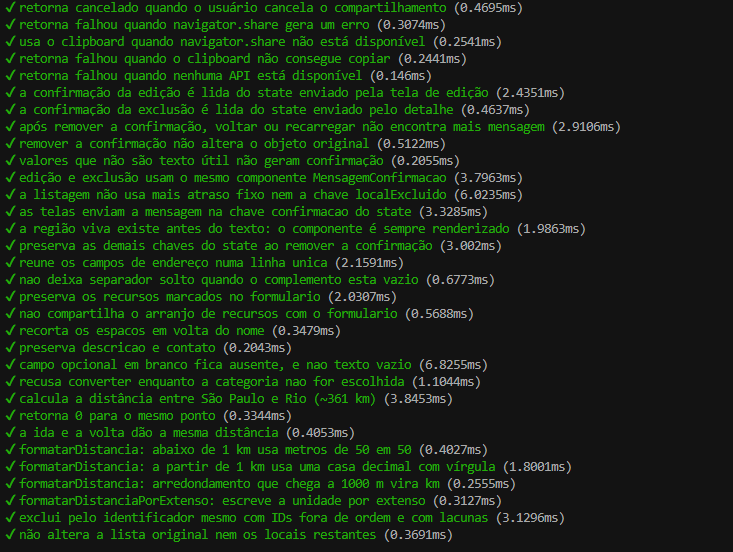
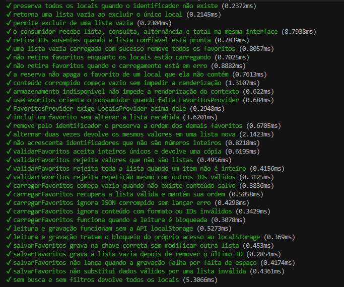
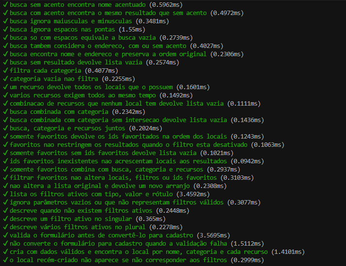
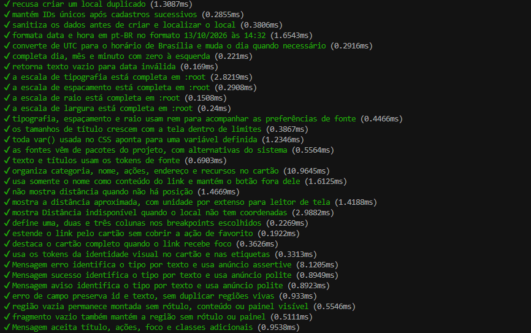
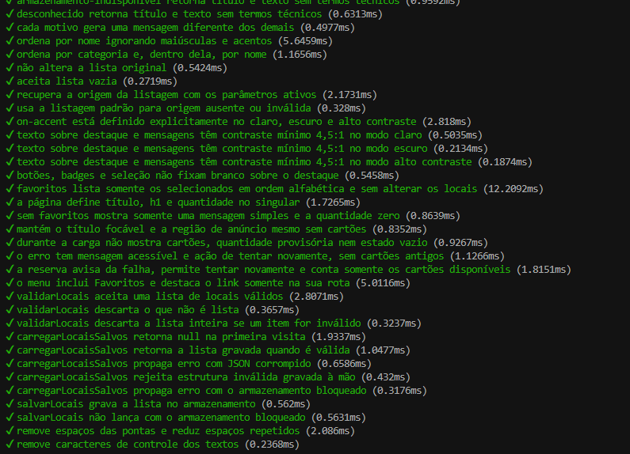
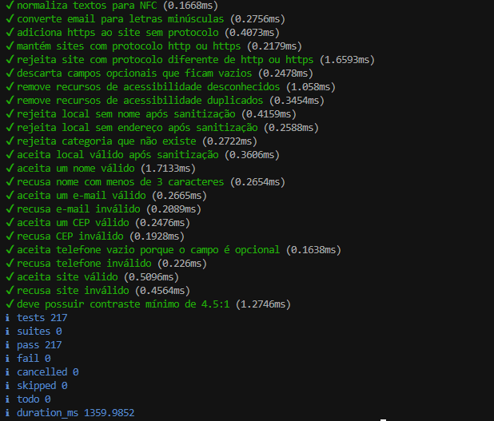

# Relatório do QA — CP3: edição, exclusão e confirmação das operações

## Identificação

- Turma: 1TDSPJ
- Squad: 5
- CP: CP3
- QA responsável: Tailyni Victoria Renovato Satirio (RM 570517, @TailyniDev)
- Data e horário: 22/10/2026, 23h
- Issue testada: #131 (critérios de #156, #142, #143 e `docs/qa/cp2/cadastro-edicao.md`)
- Pull Request: `Closes #131`
- Versão ou commit: `4e11b5f` (`develop`, merge do PR #187)
- Ambiente: `npm run dev` em `http://localhost:5173` (contexto seguro)
- Link ou identificação do ambiente testado: `http://localhost:5173`

## Escopo do teste

**Testado neste ciclo**

- Confirmação após **editar** um local (aparece no detalhe uma única vez).
- Confirmação após **excluir** um local (aparece na listagem uma única vez, com busca e filtros ativos).
- Comportamento de **Voltar**, **Avançar** e **recarregar** para cada confirmação.
- **Cópia do link** do detalhe e abertura em outra aba.
- Anúncio **uma única vez** em leitor de tela (NVDA).
- Teste automatizado novo: `tests/confirmacaoEdicaoExclusao.test.mjs`.

**Fora do escopo** (conforme a Issue): correção de defeitos (cabe ao DEV), validação do cadastro (CP2) e criação de requisito novo.

## Pré-condições e dados

- Estado inicial: `localStorage` **limpo** em todos os cenários.
- Dados utilizados: local "Biblioteca Parque"; busca `biblioteca`; filtro de categoria "Cultura".
- Navegador e dispositivo: Google Chrome, Windows 11 (computador). Não foi testado em celular.
- Leitor de tela: NVDA, no Chrome.
- Dependências: #156 (`MensagemConfirmacao`) e #142 (botão "Compartilhar local") estão em `develop`. A #143 (confirmação visual "Link copiado") **não está em `develop`** no commit `4e11b5f`: não há esse texto em `src/`.

## Critérios de aceite

| Critério | Resultado | Evidência | Observação |
|---|---|---|---|
| Relatório lista cada cenário com o resultado obtido | Aprovado | Este arquivo | Tabelas de cenários abaixo |
| Voltar, avançar e recarregar executados para cada confirmação | Aprovado | E3, E4, X3, X4, X5 | Edição e exclusão; a mensagem não reaparece |
| Teste com leitor de tela registrado, informando qual | Aprovado | L1, L2, L4 | NVDA no Chrome. A confirmação da cópia (L3) está bloqueada pela #143 |
| Cada defeito tem Issue própria com passos para reproduzir | Aprovado | Tabela de defeitos | Nenhum defeito encontrado |
| Ao menos um teste automatizado novo em `npm test` | Aprovado | Seção "Teste automatizado" | 9 testes novos; 217 passando, 0 falhas |
| Relatório informa navegador, dispositivo e commit | Aprovado | Seção Identificação | |
| Ao menos 2 commits autorais e relevantes | Aprovado | Histórico do PR | 1) teste automatizado; 2) relatório |
| `npm run lint`, `npm run build`, `npm test` sem erros | Aprovado | Seção "Teste automatizado" | |
| PR revisado antes do merge em `develop` | Pendente | PR | Aguarda a revisão; o QA não faz o merge |

## Cenários de teste

### Edição

| ID | Passos | Resultado esperado | Resultado encontrado | Situação |
|---|---|---|---|---|
| E1 | Abrir um local > "Editar local" > alterar o nome > "Salvar alterações" | Vai ao detalhe e mostra "<nome> foi atualizado com sucesso." | Mensagem exibida no detalhe | Aprovado |
| E2 | Conferir o texto na tela | Rótulo "Sucesso:" + mensagem | Rótulo e mensagem exibidos | Aprovado |
| E3 | Após E1, Voltar e Avançar do navegador | Mensagem não reaparece | Não reapareceu | Aprovado |
| E4 | Após E1, recarregar (F5) o detalhe | Mensagem não reaparece; dados editados permanecem | Não reapareceu; dados mantidos | Aprovado |
| E5 | Editar de novo e salvar | Nova confirmação aparece uma vez | Apareceu uma vez | Aprovado |
| E6 | Entrar no detalhe vindo da listagem com busca/filtro, editar e voltar à listagem | Busca e filtros continuam na URL | Preservados | Aprovado |
| E7 | Apagar o nome e tentar salvar | Erro de validação, sem mensagem de sucesso | Erro exibido, sem sucesso | Aprovado |
| E8 | Editar e clicar "Cancelar" | Volta ao detalhe sem confirmação | Sem confirmação | Aprovado |

### Exclusão

| ID | Passos | Resultado esperado | Resultado encontrado | Situação |
|---|---|---|---|---|
| X1 | Detalhe > "Excluir local" > "Excluir" | Listagem com "Local <nome> excluído com sucesso."; item some | Mensagem exibida; item removido | Aprovado |
| X2 | Repetir X1 com busca e filtros ativos | Confirmação aparece e busca/filtros continuam na URL | Preservados | Aprovado |
| X3 | Após X1, Voltar e Avançar | Mensagem não reaparece; local não volta | Não reapareceu | Aprovado |
| X4 | Após X1, recarregar a listagem | Mensagem não reaparece | Não reapareceu | Aprovado |
| X5 | Repetir Voltar/Avançar na listagem filtrada | Filtros preservados; sem mensagem | Preservados; sem mensagem | Aprovado |
| X6 | "Cancelar" e `Esc` no diálogo | Fecha, foco volta ao botão, sem confirmação | Conforme esperado | Aprovado |
| X7 | Conferir se a confirmação não depende de atraso | Anunciada logo após a navegação | Sem atraso perceptível | Aprovado |

### Cópia do link

| ID | Passos | Resultado esperado | Resultado encontrado | Situação |
|---|---|---|---|---|
| C1 | "Compartilhar local" em `localhost` (Chrome desktop) | Link copiado | Link copiado | Aprovado |
| C2 | Colar em outra aba | Abre o mesmo local | Abriu o mesmo local | Aprovado |
| C3 | Conferir "Link copiado. Agora é só colar onde quiser." | Mensagem de sucesso perto do botão | Mensagem não exibida: a #143 não está em `develop` | **Bloqueado** |
| C4 | Clicar duas vezes seguidas | Confirmação anunciada nas duas vezes | Depende da #143 | **Bloqueado** |
| C5 | Negar permissão da Área de Transferência | Campo "Copie o link do local" selecionado | Não executado | Não executado |
| C6 | Cancelar o menu de compartilhamento (celular) | Sem mensagem ou erro | Sem celular disponível | Não executado |
| C7 | Celular: botão abre o menu nativo | Menu do sistema abre | Sem celular disponível | Não executado |

### Leitor de tela (NVDA, Chrome)

| ID | Passos | Resultado esperado | Resultado encontrado | Situação |
|---|---|---|---|---|
| L1 | Editar e salvar com o leitor ligado | Anuncia a confirmação uma vez | Anunciada uma vez | Aprovado |
| L2 | Excluir com o leitor ligado | Anuncia a confirmação uma vez | Anunciada uma vez | Aprovado |
| L3 | Copiar o link com o leitor ligado | Anuncia a confirmação (#143) | Depende da #143 | **Bloqueado** |
| L4 | Voltar/Avançar após L1 e L2 | Nada é anunciado de novo | Nada anunciado | Aprovado |

### Verificados por automação

| Cenário | Resultado esperado | Resultado encontrado | Situação |
|---|---|---|---|
| Confirmação da edição lida do `state` | Texto retornado | Texto retornado | Aprovado |
| Confirmação da exclusão lida e histórico limpo | `state` vira `null` | `null` | Aprovado |
| Voltar/recarregar após remoção | Sem confirmação | Sem confirmação | Aprovado |
| Remoção não altera o objeto original | Objeto intacto | Objeto intacto | Aprovado |
| Valores inválidos (`null`, `""`, `"   "`, número) | Sem confirmação | Sem confirmação | Aprovado |
| Detalhe e listagem usam `<MensagemConfirmacao />` | Mesmo componente | Confirmado no código | Aprovado |
| Sem `setTimeout` / `localExcluido` na listagem | Removidos | Removidos | Aprovado |
| Telas enviam `state: { confirmacao }` | Chave única | Confirmado no código | Aprovado |
| Região viva sempre montada | Sem condicional em volta de `Mensagem` | Confirmado no código | Aprovado |

## Teste automatizado

Arquivo novo: `tests/confirmacaoEdicaoExclusao.test.mjs` (`node:test`, executado por `npm test`).

## Defeitos encontrados

| Issue | Gravidade | Resumo | Situação |
|---|---|---|---|
| Nenhum | — | Nenhum defeito encontrado nos cenários executados | — |

A ausência da confirmação "Link copiado" não é defeito desta demanda: ela é escopo da #143, ainda não entregue em `develop`.

## Reteste

- Data: —
- Versão: —
- Correção confirmada: —
- Novos problemas: —
- Evidências: —

Reteste necessário apenas quando a #143 for mesclada, para os cenários C3, C4 e L3.

## Decisão

- [ ] Aprovado
- [x] Aprovado com ressalva
- [ ] Reprovado
- [ ] Bloqueado

## Justificativa da decisão

Todos os cenários executados de edição e exclusão passaram: a confirmação aparece uma vez e não reaparece ao voltar, avançar ou recarregar, a busca e os filtros foram preservados e o NVDA anunciou cada confirmação uma única vez. O link do detalhe foi copiado e abriu o mesmo local em outra aba. Nenhum defeito foi encontrado.

A ressalva é que os cenários C3, C4 e L3 ficaram **Bloqueados**, porque a #143 (confirmação visual de cópia) ainda não está em `develop`; por isso não foram reprovados. Os cenários C5, C6 e C7 não foram executados (sem celular e sem teste de permissão negada). Esses pontos devem ser retestados quando a #143 for entregue.

## Declaração do QA

- [x] Testei a versão identificada neste relatório.
- [x] Não criei requisito novo para reprovar a demanda.
- [x] Registrei os defeitos de forma reproduzível.
- [x] Não incluí dado pessoal, senha ou token nas evidências.